---
hide:
  - toc
  - navigation
---

# Features

Gramps Web is a web app for collaborative genealogy. It is built on [Gramps](https://gramps-project.org/), the open-source genealogy program, and works with the same data. You can run it on your own server or use a hosting provider.

[Try the demo](#demo){ .md-button .md-button--primary } [Get started](../install_setup/setup.md){ .md-button }

## Explore your family tree { .feature-group }

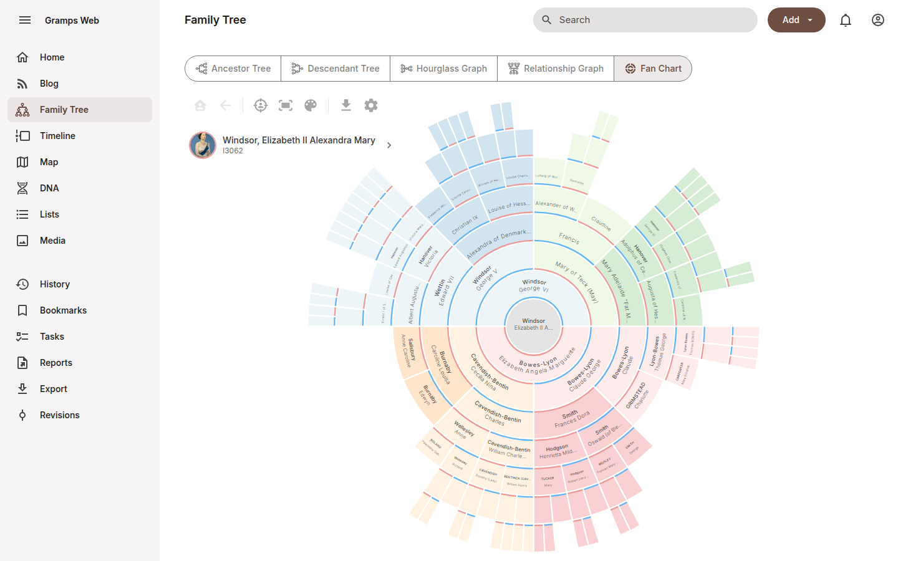{ align=right width="400"}

### Interactive family tree graphs

Navigate your family tree as an ancestor tree, descendant tree, hourglass graph, relationship graph, or fan chart, with high-quality interactive graphics and a configurable number of generations.

Hover over any person to see a preview card with their key facts, and jump straight from the chart to the full detail page.

---

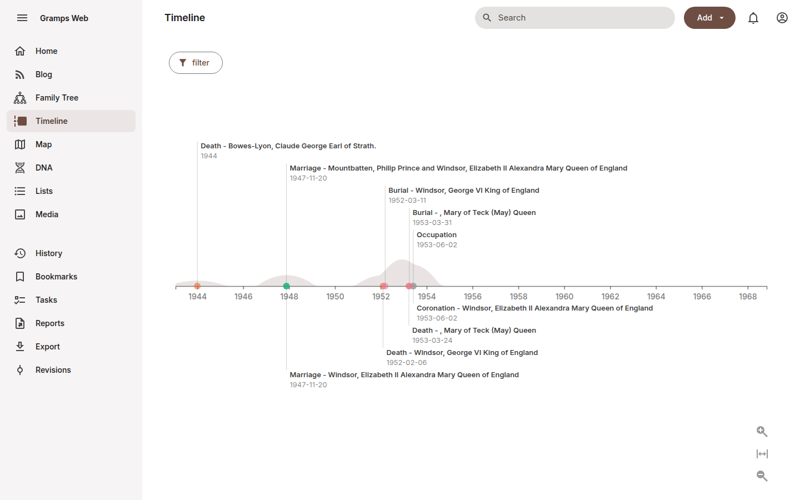{ align=left width="400"}

### Chronological timeline

See every event in your family tree laid out on a horizontal, zoomable timeline. Scroll and zoom through the centuries, then filter down to a single person – or to all of their ancestors or descendants – or to everything that happened in one place.

See [Timeline](../user-guide/timeline.md).

---

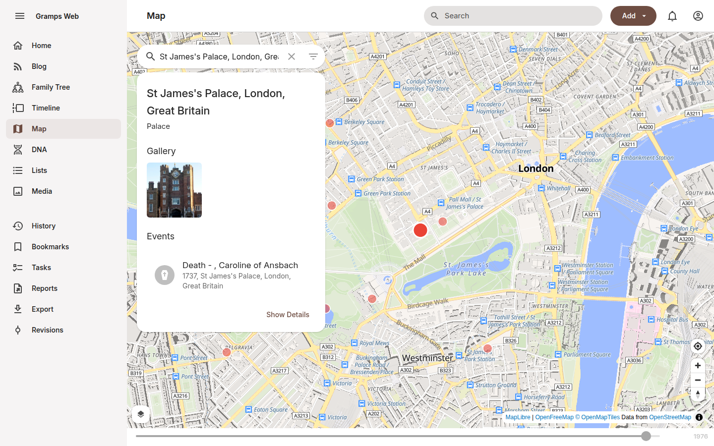{ align=right width="400"}

### Interactive map

Display all places in your tree on an interactive, searchable map. Search for new places directly on OpenStreetMap when creating a place, plot the people in your database geographically, and trace a single person's life by connecting their events with lines on the map.

---

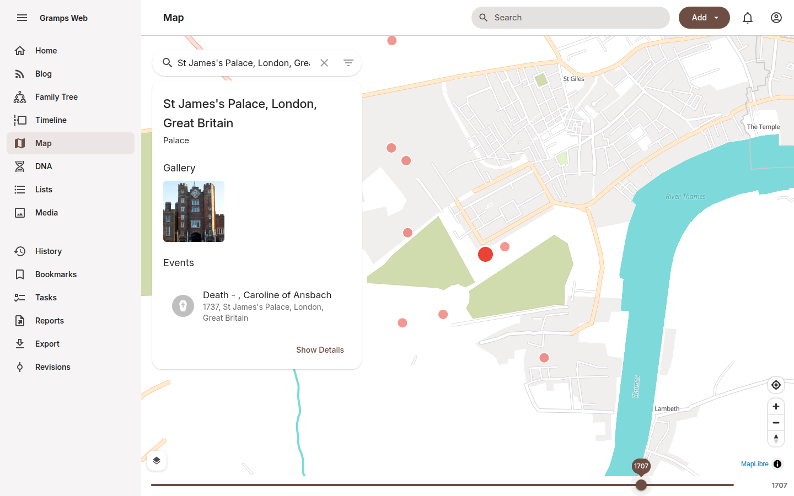{ align=left width="400"}

### Historical maps

Turn a historical map stored as a media object in Gramps into a custom map overlay.

You can also switch to the historical vector maps of the [OpenHistoricalMap](https://www.openhistoricalmap.org/) project. Use the time slider to scroll through the evolution of the places in your family history and display the places where ancestors lived or events happened.

---

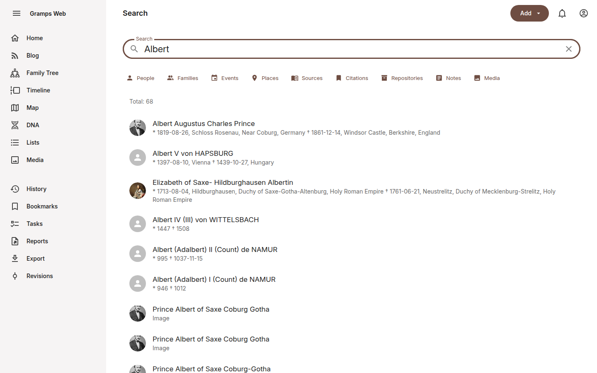{ align=right width="400"}

### Find anything

The full-text search engine covers all Gramps object types, including the content of text notes, and supports wildcards and logical operators.

For precise queries, the object list views offer an advanced filter mode based on the [Gramps Object Query Language](../user-guide/goql.md), alongside quick filters by text, tag, and privacy.

From any person's page, [External Search](../user-guide/external-search.md) opens a pre-filled search on FamilySearch, Ancestry, CompGen and other sites – and you can add your own.

## Build and research { .feature-group }

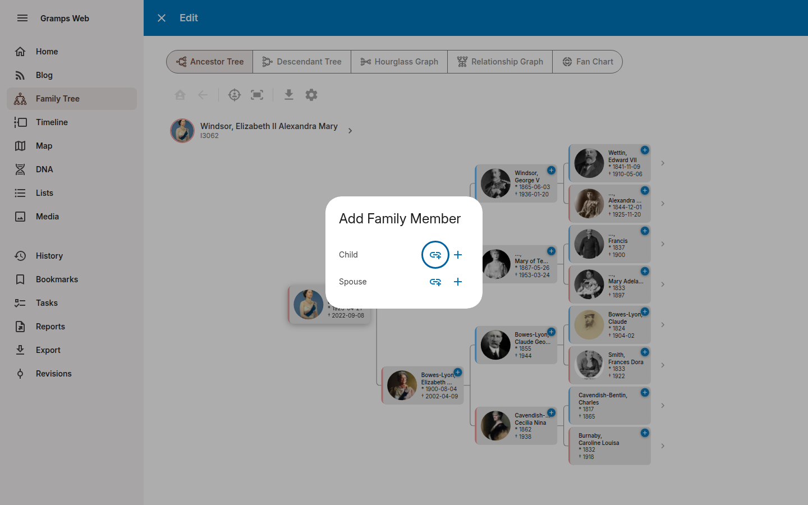{ align=left width="400"}

### Build your tree right in the chart

Switch the tree view into edit mode and grow your family tree without leaving the chart. Every person card gets a **+** button to add a father, mother, child, or spouse – either linking someone already in your database or creating a brand new person on the spot. Each change is saved immediately.

See [Editing the Family Tree](../user-guide/tree-edit.md).

---

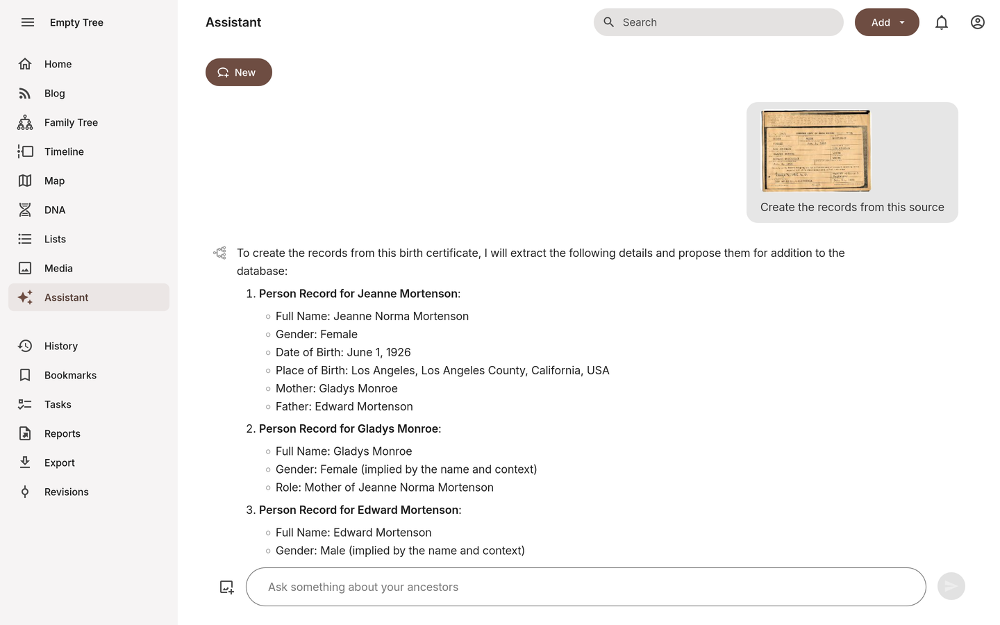{ align=right width="400"}

### Integrated AI assistant

Ask questions about your family tree in your own language, and get answers based on your data.

The assistant doesn't just search: it queries your database directly with a set of tools, filtering people, events, families and places, and calculating relationships between individuals. You can watch which tools it is using as it builds an answer, and longer questions run as background tasks so you can navigate away and come back.

The assistant is optional and needs to be [set up by the server administrator](../install_setup/chat.md) with an AI model provider.

---

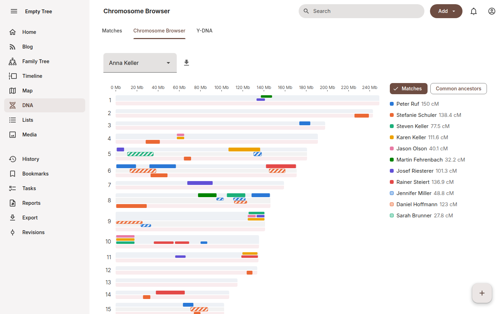{ align=left width="400"}

### DNA matches, chromosome browser & Y-DNA

Upload DNA match data from your DNA testing provider, store it alongside your family tree, and view your matches in an interactive chromosome browser.

Raw Y chromosome SNP data can be used to determine a person's most likely [Y-DNA haplogroup](../user-guide/y-dna.md) and display their patrilineal ancestors in the human Y chromosome tree, with timing estimates. The analysis runs entirely on your own server – no data is sent to any third party.

---

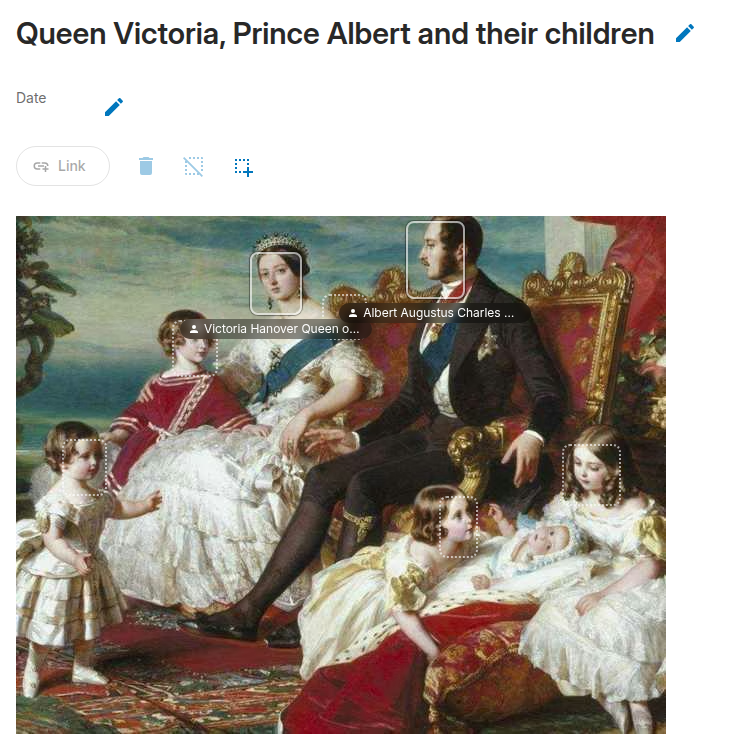{ align=right width="400"}

### Tag people in photos with automated face detection

Identify ancestors in old family photos together with your relatives. Faces are detected automatically, so tagging a person takes two clicks.

---

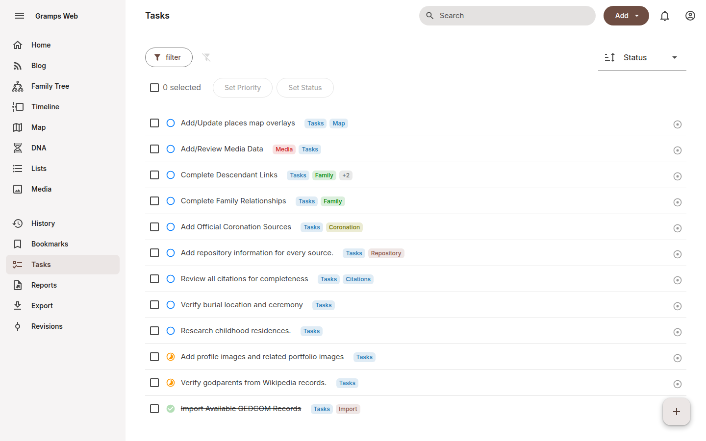{ align=left width="400"}

### Integrated task management app

Gramps Web comes with an integrated task management app to organize and plan your genealogical research. Give each task a status, a priority and tags, document your progress in a rich-text description, and attach the media you gathered along the way.

The tasks are stored as sources in the Gramps database, so they form part of your genealogical data and can be accessed and edited in Gramps Desktop as well.

---

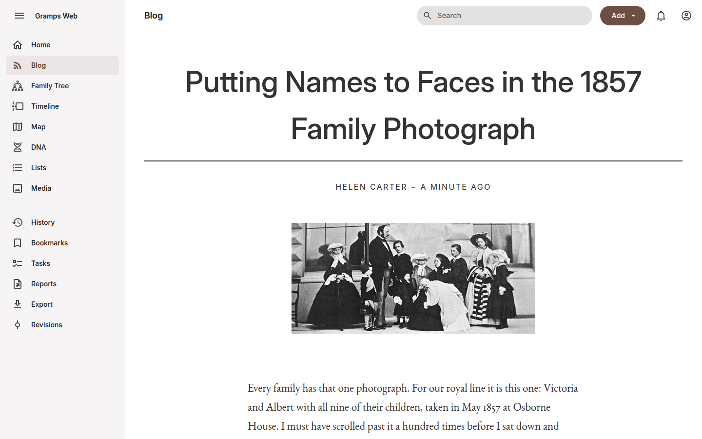{ align=right width="400"}

### Genealogy blog included

Summarize your research in the form of blog stories with pictures, and share them with your relatives. A dedicated editor makes writing a new post straightforward. All data is stored in the Gramps database.

## Work together { .feature-group }

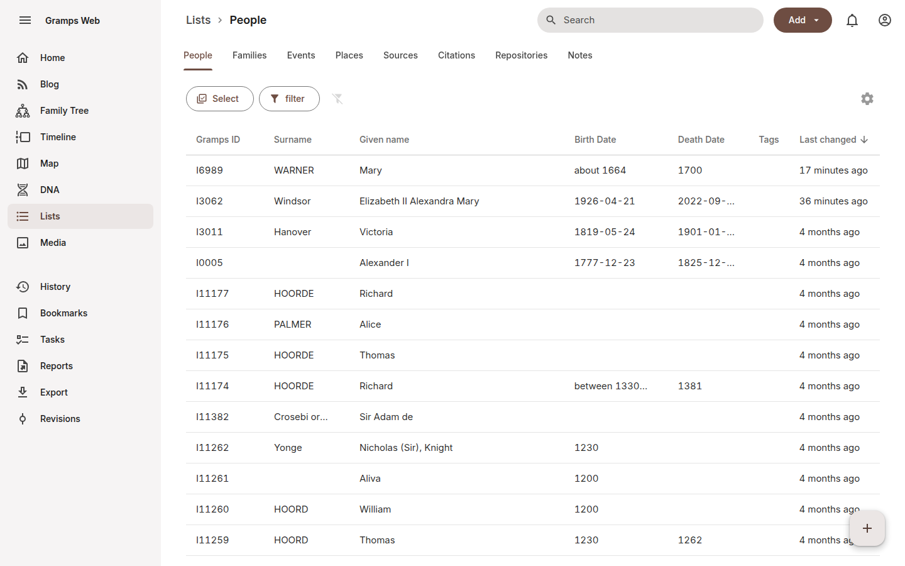{ align=left width="400"}

### Privacy levels & user access

You can [mark records as private](../user-guide/privacy.md) – down to a single name, event link, or DNA match – and control which users are allowed to view private records. Private records are filtered out at the database layer for maximum security. In addition, you can control what users are able to add and edit.

Users can sign in with a password, or through an external identity provider using [OpenID Connect](../install_setup/oidc.md) – Google and Microsoft out of the box, plus custom providers such as Keycloak, Authentik and Authelia.

---

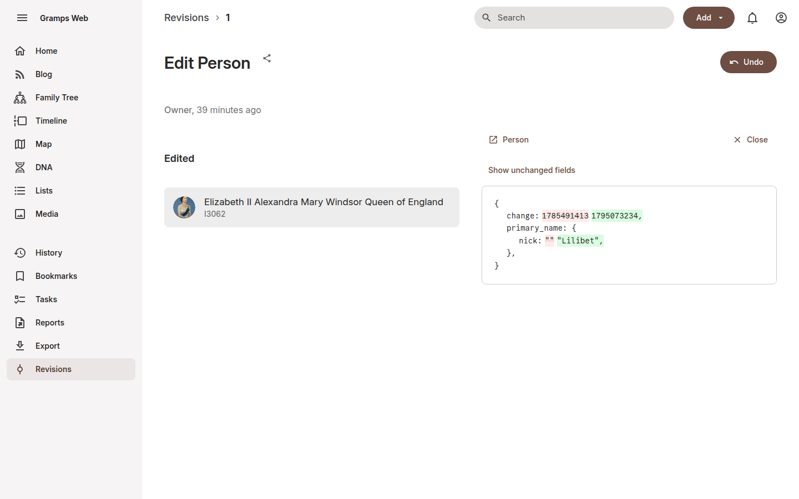{ align=right width="400"}

### Full revision history – with undo

Every edit to your family tree is recorded. Browse the complete history grouped by transaction, drill down into any individual change to see exactly which fields were added, removed or modified, and undo a transaction if it turns out to be a mistake. Every object's page also has its own revision tab showing who changed it and when.

See [Revision History](../user-guide/revisions.md).

---

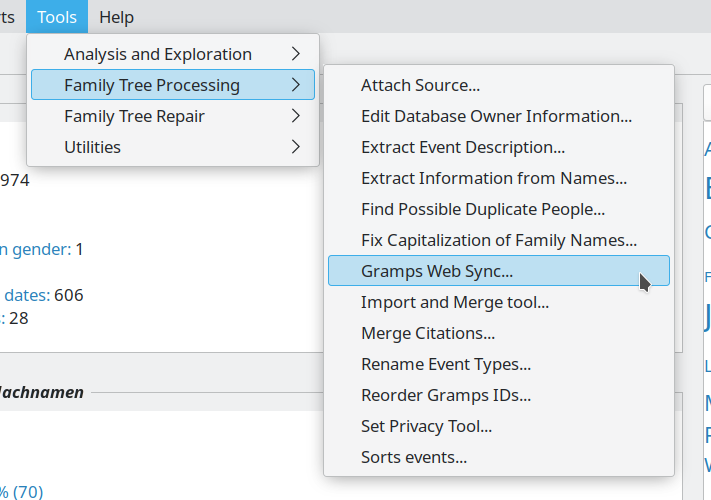{ align=left width="300"}

### Full integration with Gramps Desktop

Gramps Web uses the same data model and database as [Gramps Desktop](https://gramps-project.org/). You can browse and edit all the same [record types](https://gramps-project.org/wiki/index.php/Gramps_Data_Model): people, families, events, places, repositories, sources, citations, media objects, and notes.

With the [Gramps Web Sync add-on](../administration/sync.md) for Gramps Desktop, you can synchronize your data in both directions, so you can keep working in Gramps Desktop and in Gramps Web side by side.

## Reports and data export { .feature-group }

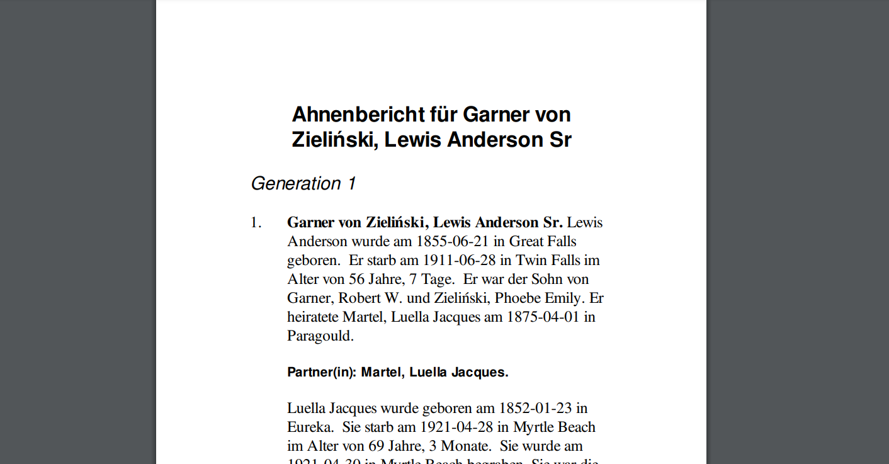{ align=right width="400"}

### Generate printable reports

Gramps Web is built on the same core as Gramps Desktop, so you can generate almost all of the [reports](https://gramps-project.org/wiki/index.php/Gramps_6.0_Wiki_Manual_-_Reports) the desktop app supports right from the browser, including relationship graphs or book reports as PDF.

---

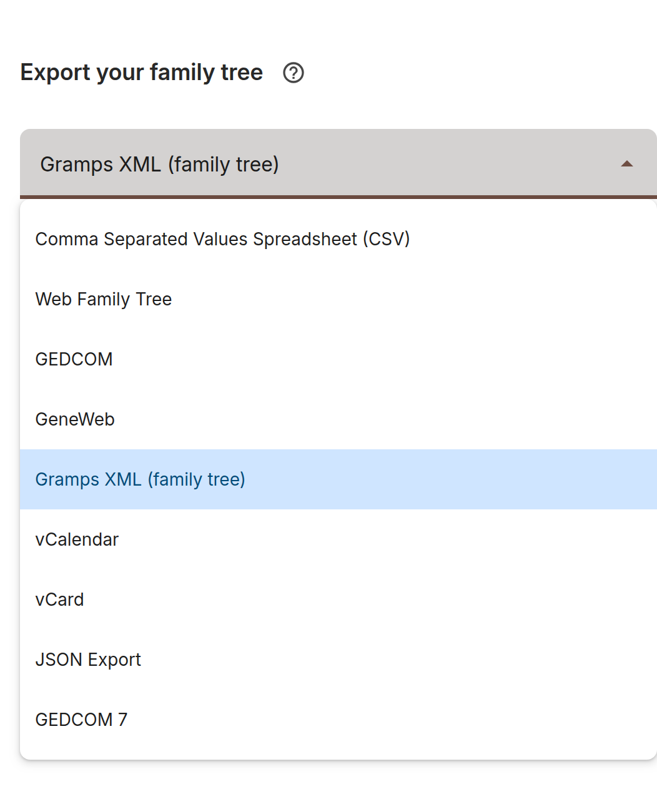{ align=left width="300"}

### No lock-in – data import and export

Import data in various formats, including Gramps XML and GEDCOM, and download all of your data at any time – family tree data, media files and user accounts – for backups or to move to a different server.

Imports can be previewed as a dry run before anything is written, and a complete backup can be restored back into the tree.

## Use it anywhere { .feature-group }

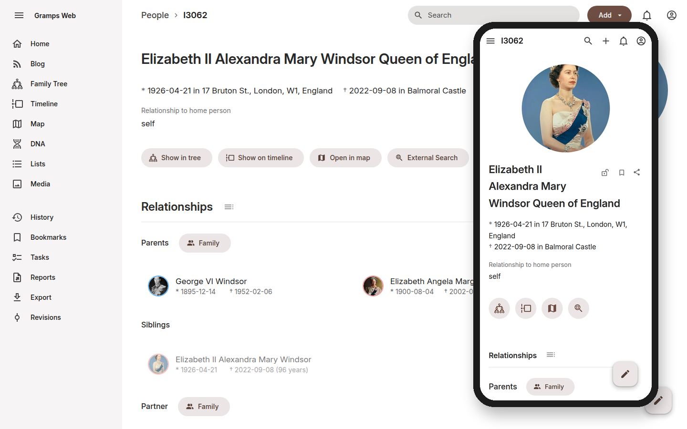{ align=right width="400"}

### Works on every device

Use Gramps Web on any device with a web browser: upload photos, create or edit records, or show your family tree to relatives at the next family reunion.

Gramps Web is a progressive web app: install it to your home screen or desktop and it behaves like a native app. On the desktop, [keyboard shortcuts](../user-guide/shortcuts.md) get you anywhere in a couple of keystrokes – press `?` to see them all.

---

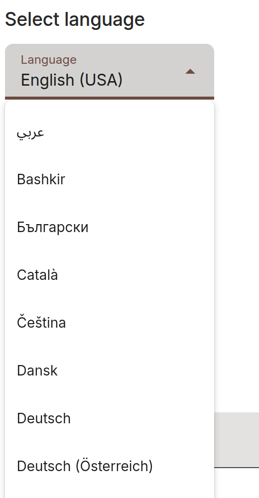{ align=left width="300"}

### Fully internationalized

Use the interface in any of more than 50 languages translated by the Gramps community.

## And more

- **Notifications and background tasks** – imports, exports, reports and index rebuilds run in the background, with progress and errors collected in one place
- **Tags, bookmarks and history** – organize objects with colour-coded tags and get back to what you were working on
- **Bulk editing** – select multiple objects in the list views to delete them at once, or merge duplicate objects
- **Customizable list views** – choose which columns to show, and filter by text, tag, or privacy
- **Text recognition (OCR)** – extract text from scanned documents in your media gallery
- **Data verification** – check your tree for implausible dates and other data problems
- **Calendars** – enter dates in the Gregorian, Julian, Hebrew, French Republican, Persian, Islamic, or Swedish calendar
- **Make it your own** – give your site its own name, theme colours, and home page text and image

## Demo

To log in to the demo, use one of the following username/password pairs. Each represents one of the user roles in Gramps Web.

`owner / owner`  
`editor / editor`  
`contributor / contributor`  
`member / member`

The demo is reset every two hours, so any changes you make are temporary.

[Go to Demo Login](https://demo.grampsweb.org/){ .md-button .md-button--primary target="_blank"}

### Thanks

The demo is kindly supported by DigitalOcean.

